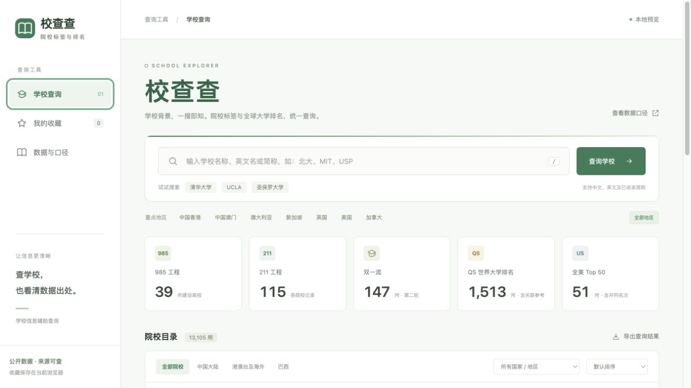
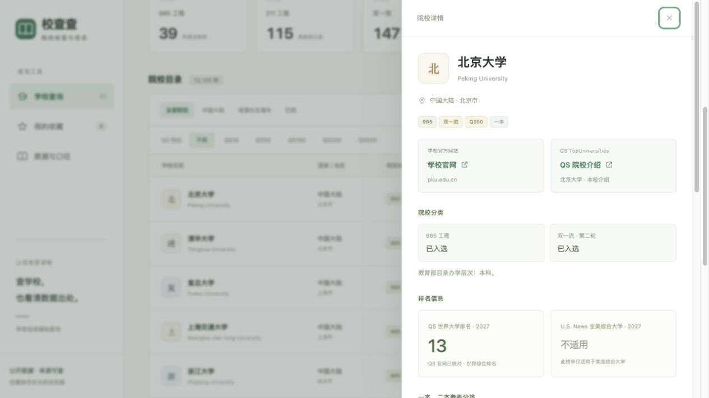

# 校查查

校查查是一个院校信息查询项目，支持中文、英文与简称搜索，查看学校标签、国内外排名及对应数据来源。使用 HTML、CSS 和原生 JavaScript，无需后端或数据库。

线上地址：[xiaochacha.vercel.app](https://xiaochacha.vercel.app/)

本地预览地址：http://localhost:4173/

在本目录运行 `npm run dev` 即可启动，无需安装第三方依赖。也可以直接运行 `node server.cjs`。不要通过 file 协议双击 index.html，因为浏览器需要通过 HTTP 读取院校数据。

本项目可作为静态站点部署到 Vercel。运行 `npm run build` 会将五个网页所需文件复制到 `dist/`，部署仅公开该目录。开发服务、说明文档和本地工作文件不会作为网页发布。

## 已实现

支持校名、英文原名和已收录简称搜索，地区与标签组合筛选、学校详情、浏览器本地收藏、复制信息、CSV 导出，以及数据来源和适用口径说明。

重点地区包含中国香港、中国澳门、澳大利亚、新加坡、英国、美国和加拿大。这七个地区共362条QS 2027院校记录均提供中文名称。其他地区也保留目录和排名记录，巴西QS高校支持中文与原文名称查询。

## 标签规则

985学校隐藏211展示标签，详情分类、复制摘要和CSV中的标签字段遵循同一规则。底层仍保留211成员关系，因此211筛选包含985学校。

QS标签按最优档位互斥展示：前10名为QS10，11至50名为QS50，51至100名为QS100，101至200名为QS200，201至500名为QS500。筛选“QS50”时包含全部前50名学校。排名区间按上限判断，501名及之后不显示这五个档位；完整原始名次或区间另行展示。

全美Top 50采用U.S. News 2027 National Universities综合大学榜的名次不超过50，包含并列，共51所，不与文理学院、专业榜或世界排名混用。

## 数据边界

数据核对日期为2026年10月23日，当前为固定快照，不自动更新。学校名、目录和排名来自教育部、QS官网、公开排名表格镜像、转录以及Hipo开放目录，具体来源见页面“数据与口径”和data.json中的sources。

教育部2026普通高校目录提供本科、专科等办学层次。中国大陆分类提供985、211、双一流、一本、二本、本科、专科和中外合办。一本、二本改用大学生必备网的全国院校常用参考名单，原始页面分别更新于2026-05-26与2025-05-08，不按候选人入学年份筛选。这是第三方参考分类，不是教育部官方等级或全国统一招生批次。按现名、已收录别名或经教育部更名文件核实的旧名精确匹配；同源名单互相冲突的学校显示分类待核验，未收录不自动归为二本，新设及合并学校不自动继承原校分类。每所已分类学校的详情、复制和CSV均包含具体名单出处。

未收录或未匹配到排名的学校显示“待核验”，不表示未上榜。目录中仍可能存在旧名、学校系统或校区名称变体。学校排名不自动继承到独立学院、分校、合作项目或学位，也不代表某位候选人的学历已经认证。

收藏存储在当前浏览器localStorage，不上传个人信息。CSV导出覆盖当前全部筛选结果，包含年份和来源链接。

## 名称合并

同一国家或地区内，英文全称仅存在括号简称、冠词或标点差异的目录记录，会在身份唯一时合并到排名主记录。保留原名称作为搜索别名，保留来源以及旧记录ID映射，并在加载页面时迁移收藏。带地名、校区或大学系统等限定的记录不通过删除括号强行合并；有歧义的同名学校保留单独记录。

跨国家或地区的同名院校会在显示名称中加注国家，保留为不同学校。National University的美国、孟加拉国与菲律宾记录已分别核对官网与所在地，显示官网域名，并在详情中提供学校身份来源；身份核对不自动赋予任何排名标签。

中外合办以及境外高校在大陆办学的学校按教育部目录备注识别，本库16所已按学校官网或教育部文件核实举办及关联高校，数据可重建。详情分别展示每一所大学的排名，中方使用软科2026中国大学主榜（已补充13所），港澳或海外使用QS2027世界综合榜。缺失名次保留待核验；不混用同名大学、不编造排名、不把学科第一名换成QS10。

QS标签、QS档位筛选及排序采用已核实的境外合作或关联大学参考，并明确显示学校名及“合作方”或“关联大学”口径。例如西交利物浦显示西安交通大学软科2026第10名和利物浦大学QS2027第139名，标签为QS200（合作方）；香港中文大学（深圳）显示香港中文大学QS2027第18名，标签为QS50（关联大学）。自身独立QS记录（如西交利物浦1001-1200）在详情单列，不覆盖原数据。复制和CSV分别包含展示QS、排名对象、本校独立QS、每所合作大学的名次及来源。

## 本地开发

需要 Node.js，在仓库根目录运行：

```bash
npm run dev
```

浏览器打开 http://localhost:4173/ 。检查 JavaScript 语法：

```bash
npm run check
```

## 目录结构

```text
index.html    页面结构
style.css     页面样式
app.js        查询、筛选、收藏、详情与导出
icon.svg      项目图标
data.json     院校、标签、排名、关联关系和来源快照
server.cjs    本地预览服务
scripts/      静态站点构建脚本
vercel.json   Vercel 静态部署配置
.vercelignore 部署时排除的文件
```

## 放到 GitHub

将本 README 所在目录作为仓库根目录即可。浏览器收藏不会写进仓库，旧版本地收藏会在首次加载时迁移。`.gitignore` 已排除本地缓存、环境变量、部署缓存和旧预览截图。


## 页面预览





## 学校官网与 QS 介绍

院校详情顶部提供“学校官网”和“QS 院校介绍”入口，在新标签页打开。官网地址按同一国家、精确校名及已核实的学校关系匹配；没有收录的入口显示待补充，不使用猜测的网址。QS链接直接打开院校介绍页，链接旁标明本校或合作／关联大学的名称。合作大学卡片也分别提供该大学的官网与已收录的QS介绍页。

## 构建与部署

```bash
npm run check
npm run build
npx vercel --prod
```

`vercel.json` 已配置静态项目、构建命令和 `dist` 输出目录，适用于个人 Hobby 免费方案。首次使用 CLI 时根据提示登录、选择个人空间并关联项目即可。后续也可在 Vercel 导入 GitHub 仓库，使用已有配置自动部署。项目没有后端、付费服务或需要提交的环境变量。

`.gitignore` 与 `.vercelignore` 会排除 AGENTS.md、agent.md 等代理指令文件、工具配置、研究记录、临时文件、环境变量及 Vercel 本地关联信息。构建过程额外采用静态文件白名单，网页只包含运行必需的文件。
